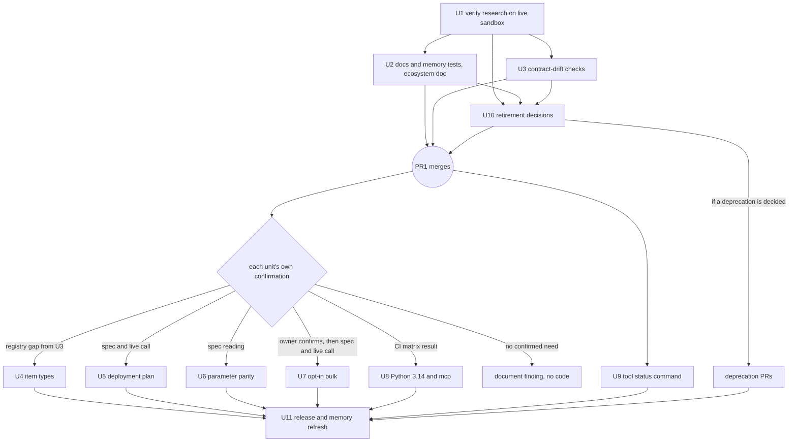

**Target repo:** `pyfabric` (all paths below are repo-relative to it). Tracking issue: [#154](https://github.com/Creative-Planning/pyfabric/issues/154). This plan is the how; the issue carries the findings table and acceptance criteria.

---

## Goal Capsule

- **Objective:** Someone adopting pyfabric today gets correct docs and agent guidance, a clear answer to "why this instead of Microsoft's own tools", and current support for the Fabric capabilities pyfabric owns. Nothing in pyfabric duplicates a first-party tool without a reason a human at a terminal would care about.
- **Means:** Evidence first, then change. Verify the research against the live sandbox, fix docs and agent memory, then make each code change only where that unit's own confirmation shows it is needed (KTD1, KTD2).
- **Authority:** Product Contract requirements win on behavior; KTDs win on mechanism. Issue #154 acceptance criteria are the done signal. `CLAUDE.md` conventions apply (ruff, `mypy --strict`, structlog, Python 3.11 floor, no PEP 695).
- **Execution profile:** Two stages. PR1 carries U1-U3 and U10 (docs, memory, tests, verification harness, the retirement decision record, and one normalizer fix the new parity test forces) and merges first. Each code change then ships as its own PR, because #154 specifies one PR per change and each touches a public contract (KTD7): U4 once U3 confirms registry gaps, U5 once its spec reading and a live call confirm the change, U6 once its spec reading confirms the gap, U7 only if the owner confirms bulk is in scope and its spec and live call confirm it, U8 once the CI matrix result shows a break, and U9 unconditionally after PR1. Any deprecation that U10 decides on ships as its own PR. U11 follows once those land. Work is test-first throughout (KTD3).
- **Stop conditions:** Stop and report if the sandbox capacity cannot be resumed, if U1's workspace safety check finds the sandbox unsafe for the REST e2e suites and no throwaway workspace is available, if a live check contradicts a research claim the plan depends on (record it, do not patch around it), or if a unit would need production data sent to a cloud AI provider.
- **Who ships:** The repository owner reviews and merges. Nothing is committed, pushed, or released without being asked.

---

## Product Contract

### Summary

An evidence-first refresh. pyfabric keeps what only it does, documents the overlap with the Fabric MCP servers, `fab`, fabric-cicd and the data-agent SDK, fixes the drift already found, and adds support for new Fabric capabilities where pyfabric owns the surface. Users get a tested way to see whether their complementary Microsoft tooling is current.

### Problem Frame

Microsoft has shipped a local and a remote Fabric MCP server (the local one is v1.8.0 as of 2026-11-11), `fab` 1.9.0, fabric-cicd 1.4.0, new item types and bulk item-definition APIs since pyfabric was last aligned with them. Part of pyfabric's REST wrapper layer now overlaps those tools for AI agents, while its git-sync byte handling, validators, ordered deploy, git client, local lakehouse and pytest plugin have no first-party equivalent.

Drift has already crept in. The generated agent memory that `pyfabric install-claude-memory` copies into consumer repos tells agents to call `workspaces.list(cred)`, which does not exist in 0.1.15. `CLAUDE.md` lists supported item types without `DataAgent` and `Ontology`, which the registry does include. `docs/execution-plan.md` justifies building `pyfabric.deploy` partly by fabric-cicd's lack of Python 3.14 support, which fabric-cicd 1.4.0 has since fixed. Nobody has validated pyfabric against live Fabric since these changes, so more drift may exist.

### Requirements

#### Verification and honesty

- R1. Every research claim a later unit depends on is verified against the live sandbox or primary sources first; claims that cannot be verified are recorded as such, not assumed.
- R2. Live validation runs only in a workspace verified safe for it (`ws_da_sandbox`, or a throwaway workspace on the same capacity), and the F2 capacity is paused again after every session once nobody else is using it.
- R3. No production data reaches a cloud AI provider; fixtures are synthetic or structure-only.

#### Docs and agent memory

- R4. Every doc, README section, docstring and memory entry that mentions an overlapping tool or a stale API is corrected, including the `workspaces.list` snippet and the `CLAUDE.md` item-type list.
- R5. A new `docs/ecosystem.md` states the overlap matrix and an adopt-first rule: MCP for ad-hoc agent operations, `fab` for interactive use, pyfabric for validated git-sync bytes, ordered deploys, local testing and CI.
- R6. Code snippets in docs and shipped memory are checked by tests so a stale call cannot recur.
- R7. The claude-memory catalog gains an MCP-versus-pyfabric entry, and `docs/execution-plan.md` and issue #42 no longer carry superseded claims.

#### Code currency (only where evidence confirms drift)

- R8. The item-type registry matches the current Fabric specs for the types pyfabric claims to support; unsupported new types are documented as such.
- R9. `GitClient.update_from_git` can pass the new optional deployment plan.
- R10. `substitute_parameters` accepts the current fabric-cicd `parameter.yml` constructs pyfabric chooses to support, says clearly which it does not, and keeps every parameter file that works today working.
- R11. Bulk import and export of item definitions is available behind an explicit opt-in, with pyfabric's default behavior unchanged.
- R12. CI covers Python 3.14, and the data-agent client works with the installed `mcp` major version.

#### Staying current

- R13. A user can get the complementary tools that pip can install through opt-in extras, and can see which complementary tools (`fab`, `az fabric`, fabric-cicd, fabric-data-agent-sdk) are installed and how they compare with the versions pyfabric was validated against. The Fabric MCP server is listed with a pointer to `docs/ecosystem.md` rather than probed. Nothing is installed without the user asking.

#### Retirement

- R14. Each pyfabric surface that overlaps a first-party tool gets a recorded keep, deprecate or remove decision against explicit criteria; removal waits at least one release behind a deprecation warning and docs pointer.

### Success Criteria

- A reviewer can open `docs/ecosystem.md` and decide in one read which tool to use for a task.
- Re-running the contract checks against the sandbox finds no unrecorded drift in the registered item types.
- A new agent session that installs pyfabric's memory is not told to call anything that does not exist.
- Issue #154's acceptance criteria are all checked.

### Scope Boundaries

#### Non-goals (considered and not built)

- Wrapping or reimplementing the Fabric MCP servers or `fab`. Their value is for agents and interactive use; pyfabric's vision is human-runnable scripts. Evidence that would change this: an MCP server gaining git-sync byte-canonical output.
- Replacing pyfabric's deploy and git layers with fabric-cicd. The `.platform` mutation and logicalId findings in `docs/execution-plan.md` still hold until re-verified in U1; fabric-cicd's Python 3.14 support removes one reason but not the others.
- A data-agent authoring layer. `fabric-data-agent-sdk` covers it and pyfabric already descoped it.
- The sempy bridge from #42. semantic-link-labs covers it.
- A scheduled or CI-enforced capacity pause. Forgetting a pause costs money visibly in Azure; U1's runbook and the Verification Contract check it, which is enough for one sandbox.

#### Deferred to Follow-Up Work

- Item types the sandbox tenant cannot create (feature not enabled): documented in U4, built when a tenant can round-trip them.
- The DirectLake partition swapper (#42 item 1), unchanged and unrelated.

### Open Questions

- Blocking for U7 only: Is bulk import/export in scope? #154 left it as an open decision with a default of yes behind a flag. The risk is that it adds a public preview parameter with no named consumer; leaving it out costs nothing because the per-item path keeps working. U7 does not start until the owner confirms.
- For the owner: R14 retires only by deprecation first, so this release may remove nothing. Do deprecation warnings satisfy "retire what pyfabric no longer needs", or should at least one clearly redundant surface be removed now? U10 records the evidence either way.
- Deferred: Which overlapping surfaces pass the retirement criteria. Answered by U10 from U1 to U3 evidence, not decidable now.
- Deferred: Whether the remote Core MCP server is preview or GA. Docs only claim it once U1 confirms it from Microsoft's own page.
- Deferred: The `az fabric` extension version and the PyPI versions of `ms-fabric-cli` and fabric-cicd. U1 records them.

---

## Planning Contract

### Key Technical Decisions

- KTD1. **Verify before change.** U1 turns every unverified research item into a recorded fact or a recorded gap before any unit depends on it. Rationale: the research came from GitHub releases and search summaries, not PyPI or running the tools.
- KTD2. **Code changes in U4-U8 are conditional on that unit's own confirmation.** No confirmed need, no change, and the finding is documented instead. The confirmation differs by unit: U3's failing registry comparison gates U4; a spec reading plus a live call gates U5 and U7; a reading of fabric-cicd's published parameter schema gates U6; the CI matrix result gates U8. U9 is not drift-gated, and the one normalizer fix in PR1 is forced by U3's parity test. Rationale: pyfabric's value is byte-canonical correctness, and speculative changes risk breaking it (see U4).
- KTD3. **Test-first for every behavior change.** The first commit of each PR adds the failing test and the PR description links it; CI is expected red on that commit. Rationale: the owner asked for it explicitly, and byte-convention bugs are cheapest to catch with a failing fixture.
- KTD4. **Contract tests read Microsoft's specs, not memory.** Item-type expectations are checked against `microsoft/fabric-rest-api-specs`, which is updated weekly; endpoint drift is left to the live suites and to each unit's own confirmation. Network-dependent checks are gated and skipped offline; an offline parity test keeps `ITEM_TYPES` and the normalizer's type list in sync. They are not in sync today: the normalizer's list lacks `Warehouse`, `Ontology` and `Map`, so U3 lands the test together with that fix, and `ITEM_TYPES` is authoritative per the "keep in sync" comment.
- KTD5. **Docs are tested.** Snippets in `docs/*.md`, `README.md` and `src/pyfabric/claude_memory/*.md` are import- and signature-checked by a test, executed only when they need no network. Rationale: the `workspaces.list` drift shipped to every consumer repo.
- KTD6. **Bulk APIs are opt-in.** The Bulk Export/Import Item Definition APIs are preview, so `publish_repo` keeps its current behavior by default and bulk is a parameter the caller sets. Rationale: a preview API must not change a default code path.
- KTD7. **One PR per confirmed code change.** The owner's tracking issue specifies it, and each change touches a public contract (registry, `GitClient`, `parameter.yml` handling, a new CLI command).
- KTD8. **Staying current is opt-in, in two parts.** Opt-in pip extras (`fabric-cli`, `cicd`, `dataagent-sdk`) let a user install the complementary Python tools at versions pyfabric validated, and a status command reports what is installed, including what pip cannot install (`az fabric`); the MCP server is listed with a docs pointer, not probed. Nothing installs unasked. Rationale: R13 asks that users get the tools, not only see them; silent installs into a user's environment are the part to avoid.
- KTD9. **No new core runtime dependencies.** The status command shells out to `fab`, `az` and similar only when present and reads installed package versions from metadata; the tools themselves arrive only through the opt-in extras. The validated-versions table lives in one packaged data file that the command reads and the docs table is tested against (KTD5). Rationale: `CLAUDE.md` keeps runtime dependencies minimal, and docs do not ship in the wheel.

### Assumptions

- The sandbox capacity `dainternalcentralusf2` can be resumed by the repository owner's identity.
- The sandbox's safety for REST round-trip tests is not assumed; U1 step 1 checks it (git connection and the scope of the orphan-delete tests) before any live suite runs.
- The `az fabric` extension can be installed into a scratch environment, or `az resource invoke-action` is an adequate fallback for resume and pause.
- The new item types' git-sync formats are discoverable from Microsoft's docs or a real round trip; if neither is, the type is documented as unsupported (U4).

### High-Level Technical Design

---

## Implementation Units

| --- | --- | --- | --- |
|---|---|---|---|
| U1 | Live baseline and verified findings | `docs/live-validation.md`, `docs/ecosystem.md` | none |
| U2 | Docs, memory and snippet tests | `docs/ecosystem.md`, `tests/test_docs_snippets.py`, `src/pyfabric/claude_memory/` | U1 |
| U3 | Contract-drift checks | `tests/contract/` | U1 |
| U4 | New item types | `src/pyfabric/items/types.py`, `src/pyfabric/items/normalize.py` | U3 |
| U5 | Git deployment plan | `src/pyfabric/client/git.py` | U3 |
| U6 | Parameter file parity | `src/pyfabric/deploy.py` | U3 |
| U7 | Opt-in bulk import/export | `src/pyfabric/deploy.py`, `src/pyfabric/items/crud.py` | PR1, owner confirmation |
| U8 | Python 3.14 and mcp compatibility | `.github/workflows/ci.yml`, `pyproject.toml`, `src/pyfabric/testing/data_agent.py` | U1 |
| U9 | Complementary-tool status command | `src/pyfabric/cli.py` | U1, U2 |
| U10 | Retirement decisions | `docs/ecosystem.md` | U1, U2, U3 |
| U11 | Release and memory refresh | `docs/` | U9, and whichever of U4-U8 and any U10 deprecations ran |

### PR1: Verification, docs, checks and retirement decisions

**Waits on:** nothing. It is the first group.

### U1. Live baseline and verified findings

- **Goal:** Establish what is true today, on the live sandbox, before anything depends on the research.
- **Requirements:** R1, R2, R3.
- **Dependencies:** none.
- **Files:** `docs/live-validation.md` (new runbook), `docs/ecosystem.md` (created here with the verified-versions table; U2 fills in the rest).
- **Approach:**
  1. Check the sandbox is safe before any live suite runs. Read `GitClient.get_status` for `ws_da_sandbox`: a git-connected workspace plus REST-created test items causes duplicate-item conflicts (`CLAUDE.md` provisioning workflow), and a later commit-to-git would push test debris. Read `tests/test_deploy_e2e.py`: its orphan deletes are scoped by item type (`Notebook`), so they can delete any other Notebook in the workspace that is not in the test repo. If either check is a problem, run the REST e2e suites in a throwaway workspace on the same capacity and keep `ws_da_sandbox` for read-only and git checks.
  2. Resume the F2 capacity with `az` before any live call. The capacity has seven listed administrators, so before pausing it at the end of the session confirm nobody else resumed it for their own work. Record the procedure and the pause check in `docs/live-validation.md`.
  3. Run the existing unit suite, then the gated live suites in the workspace step 1 approved (`PYFABRIC_TEST_WORKSPACE_ID`, plus the lakehouse variable for the DDL suite). Record pass, fail and skip counts.
  4. In a scratch environment outside both repos, install `fab` and the `az fabric` extension. Record exact versions and what `fab` offers (command groups, `fab api` if present).
  5. Confirm from Microsoft's own pages whether the remote Core MCP server is preview or GA, and the PyPI versions, Python ranges and dependency weight of `ms-fabric-cli`, fabric-cicd and fabric-data-agent-sdk (the data-agent SDK reportedly needs Python below 3.14 and pulls in sempy, which affects U8 and U9).
  6. Re-verify the three `docs/execution-plan.md` Phase C findings (`.platform` mutation, logicalId zeroing, git-sync-only pinning) against current Fabric behavior.
- **Execution note:** This unit produces recorded facts, not code. Anything that contradicts a research claim becomes a documented correction, not a silent change.
- **Test scenarios:** Test expectation: none -- evidence-gathering and a runbook. The existing suites are the checks and their results are the output.
- **Verification:** Every unverified item from #154 is either a dated fact with a source or an explicit gap; the workspace safety result is recorded; the capacity is paused once no one else is using it; the baseline results are recorded.

### U2. Docs, memory and snippet tests

- **Goal:** Make every doc and shipped memory entry correct, and keep it correct.
- **Requirements:** R4, R5, R6, R7.
- **Dependencies:** U1.
- **Files:** `docs/ecosystem.md`, `README.md`, `CLAUDE.md`, `docs/api.md`, `docs/deploy.md`, `docs/data-agent.md`, `docs/execution-plan.md`, `docs/roadmap.md`, `src/pyfabric/claude_memory/pyfabric.md`, `src/pyfabric/claude_memory/mcp_vs_pyfabric.md` (new), `src/pyfabric/claude_memory/MEMORY.md`, `tests/test_docs_snippets.py` (new), `tests/test_claude_install.py`.
- **Approach:**
  1. Write the snippet tests first and watch the `workspaces.list` snippet fail them. Classify fences up front so the gate is green for the right reasons: a fence that fails `ast.parse`, starts with a notebook magic (such as `%pip`), or carries an explicit skip marker is skipped; every parseable fence has its `pyfabric` imports and attribute calls resolved against the installed package, with placeholder names such as `cred`, `WS` and `LH` bound to stubs.
  2. Fix that snippet in full (it also reads `ws.display_name` and `ws.id` as attributes, but `list_workspaces` returns dicts keyed `displayName` and `id`), the `CLAUDE.md` item-type list (missing `DataAgent` and `Ontology`), and the superseded Python 3.14 claim in `docs/execution-plan.md`.
  3. Fill `docs/ecosystem.md` (created in U1 with the verified-versions table): overlap matrix, adopt-first rule, unique-value list, and the retirement criteria (U10 records the decisions).
  4. Add the MCP-versus-pyfabric memory entry and its index line, so installed memory carries the adopt-first rule.
  5. Mark the sempy bridge dropped in #42.
  6. Sweep every remaining mention of an overlapping tool in the files above.
- **Execution note:** Implement test-first. The snippet test must fail on the current memory before the fix lands.
- **Patterns to follow:** `tests/test_claude_install.py` already asserts the memory index references every catalog file; extend that pattern rather than adding a parallel mechanism.
- **Test scenarios:**
  - A fenced Python snippet in `src/pyfabric/claude_memory/pyfabric.md` that imports or calls a name absent from the installed package fails the test.
  - The corrected `list_workspaces(FabricClient(...))` snippet passes the signature check and also runs against a fake client returning dict items, so attribute access on a dict fails the test.
  - Every fenced snippet in every file under `src/pyfabric/claude_memory/` is checked, not only `pyfabric.md`; the `LocalLakehouse`, `FabricSql`, `OpenMirrorClient` and `DataAgentClient` examples are covered.
  - A snippet in `README.md` or `docs/api.md` referencing a renamed function fails with the file and line in the message.
  - Snippets marked as needing network or credentials are signature-checked but not executed.
  - The new memory entry is referenced by the index and shipped in the wheel's catalog, so `test_index_references_every_catalog_file` still passes.
  - Edge: a doc with no Python fences is skipped without error.
  - A fence starting with a `%pip` magic line or containing `...` placeholder fragments is skipped, while a parseable fence calling a name that does not exist still fails.
- **Verification:** docs-lint (codespell, markdownlint) passes; the snippet test is green; `install-claude-memory --dry-run` lists the new entry.

### U3. Contract-drift checks

- **Goal:** Make item-type registry drift detectable by a test instead of by memory.
- **Requirements:** R1, R8.
- **Dependencies:** U1.
- **Files:** `tests/contract/` (new: item-type registry check, normalizer parity check), `tests/items/test_types.py`, `src/pyfabric/items/normalize.py`, `tests/items/test_normalize.py`.
- **Approach:**
  1. Add an offline parity test asserting `ITEM_TYPES` keys equal the normalizer's `_ITEM_TYPES` set. It fails today because the normalizer lacks `Warehouse`, `Ontology` and `Map`; land it with the fix that adds them, plus a normalizer test covering the workspace-root walk for those suffixes. This is the only behavior change in PR1, and its failing test is the entry ticket (KTD2).
  2. Add a network-gated check that compares registered item types against `microsoft/fabric-rest-api-specs`, reporting missing and extra types.
  3. Run the gated check once live and record its output in `docs/ecosystem.md`; the registry output decides whether U4 proceeds. It does not gate U5-U8, which confirm themselves.
- **Execution note:** Start with the failing parity and drift tests. The gated check is expected to fail until U4 lands for any confirmed gap.
- **Test scenarios:**
  - Adding a key to `ITEM_TYPES` without updating the normalizer set fails the parity test.
  - A file under a `*.Warehouse`, `*.Ontology` or `*.Map` folder resolves its workspace root through the normalizer's ancestor walk, so type-specific rules apply to it.
  - Characterization: an already-canonical file under each of those three folder types is byte-identical after normalization, so existing consumer files do not change.
  - A spec folder with no registry entry is reported as a gap, naming the type.
  - A registry type absent from the specs is reported as extra, not an error, because pyfabric may support types ahead of the spec snapshot.
  - Offline, the network-gated check is skipped with a visible reason.
  - Spec fetch failure produces a skip, not a false pass.
- **Verification:** The parity test is green and permanent in CI; the gated check's live output is recorded and lists the confirmed gaps.

### U10. Retirement decisions

- **Goal:** Record a keep, deprecate or remove decision for each overlapping surface, so the "retire what is no longer needed" outcome has evidence behind it from the first PR.
- **Requirements:** R14.
- **Dependencies:** U1, U2, U3.
- **Files:** `docs/ecosystem.md`. A deprecation, if one is decided, touches the affected module and its test in its own PR (KTD7).
- **Approach:**
  1. Apply the three criteria from #154 to each candidate: a first-party tool covers it (verified by running that tool in U1), pyfabric adds no distinguishing guarantee, and no documented consumer workflow breaks.
  2. Candidates are the thin REST wrappers in `src/pyfabric/workspace/workspaces.py`, `src/pyfabric/items/crud.py` and `src/pyfabric/items/jobs.py`, and `pyfabric.deploy` itself. Decide each from the evidence, not in advance.
  3. Check the consumer repos the owner controls for use of each candidate before deprecating it.
  4. For each deprecation, the follow-up PR adds a `DeprecationWarning` and a docs pointer; removal is a later release (R14).
- **Execution note:** Test-first for each deprecation PR: assert the warning fires and the behavior is otherwise unchanged. The decision record itself is documentation.
- **Test scenarios:**
  - A deprecated function emits one `DeprecationWarning` naming its replacement and still returns the same result.
  - A kept surface has a docs note stating why, checked by the snippet test.
  - Edge: a surface used by a consumer repo is kept regardless of overlap.
- **Verification:** Every candidate has a recorded decision in `docs/ecosystem.md`; the owner's answer on the retirement question (Open Questions) is recorded; no removal ships in this work.

### PR2 onward: Confirmed code changes

**Waits on:** PR1, merge order and needed before start. U4-U8 are each set by their own confirmation (KTD2); a unit with no confirmed need becomes a documented finding, and U7 also waits on the owner. U9 is not drift-gated. Each unit, and each deprecation U10 decides on, ships as its own PR because #154 specifies it (KTD7).

### U4. New item types

- **Goal:** Register the new Fabric item types pyfabric can support correctly.
- **Requirements:** R8.
- **Dependencies:** U3.
- **Files:** `src/pyfabric/items/types.py`, `src/pyfabric/items/normalize.py`, `tests/items/test_types.py`, `tests/items/test_normalize.py`, `tests/fixtures/` (one fixture folder per type).
- **Approach:**
  1. Candidates are GraphModel, Cosmos DB, DataBuildToolJob, WarehouseSnapshot, AnomalyDetector, Plan and DeploymentPlan. Take the list from U3's output, not from this plan.
  2. For each candidate, capture a canonical fixture from a real Fabric round trip (git sync or `fab` export), never a hand-written shape.
  3. Register only types with a captured fixture and a known required-file set, with byte conventions added to the normalizer's rule table.
  4. Types the sandbox cannot create go to Deferred to Follow-Up Work with the reason.
- **Execution note:** Test-first. The fixture-based validation test fails for each type before it is registered.
- **Patterns to follow:** The `DataAgent` registration (`src/pyfabric/items/types.py`) and its CRLF no-trailing-newline rule in the normalizer.
- **Test scenarios:**
  - A captured fixture for a new type passes `validate_item` after registration and fails before.
  - A fixture saved through `write_artifact_file` is byte-identical to its captured original.
  - An unregistered type still validates as unknown with the existing message.
  - The offline parity test (U3) passes with the new type in both lists.
  - Edge: a type with no required files (like `Warehouse`) validates with only `.platform`.
- **Verification:** Every registered new type round-trips through the sandbox without a git diff; the contract check from U3 no longer reports it missing.

### U5. Git deployment plan

- **Goal:** Let `GitClient.update_from_git` carry the optional deployment plan.
- **Requirements:** R9.
- **Dependencies:** U3.
- **Files:** `src/pyfabric/client/git.py`, `tests/client/test_git.py`.
- **Approach:**
  1. Confirm the request shape for the deployment plan from Microsoft's git automation docs (updated 2026-09-24) and a live call, since the deployment-plan automation doc is the only source.
  2. Add an optional keyword that defaults to today's behavior; the request body is unchanged when it is not set.
- **Execution note:** Test-first. The first test asserts the existing request body is byte-identical when the option is unset, then a failing test for the new field.
- **Test scenarios:**
  - Calling without the option sends exactly the current body.
  - Calling with a deployment plan includes it in the body in the documented position.
  - An invalid plan value raises a clear error before any request is sent.
  - A server error (for example `PrincipalTypeNotSupported`) surfaces as the existing error type with the code intact.
- **Verification:** Existing git-client tests are unchanged and green; a live call against the sandbox with a plan succeeds or the tenant limitation is documented.

### U6. Parameter file parity

- **Goal:** Bring `substitute_parameters` in line with the fabric-cicd `parameter.yml` constructs pyfabric chooses to support.
- **Requirements:** R10.
- **Dependencies:** PR1.
- **Files:** `src/pyfabric/deploy.py`, `tests/test_deploy.py`, `docs/deploy.md`.
- **Approach:**
  1. Read fabric-cicd 1.4.0's published parameter schema (no live call is involved) and list the constructs it supports that pyfabric does not: dynamic variables, `$workspace.$name`, `$sqlendpoint`, and entry-level scoping keys such as `item_type`, `file_path` and `is_regex`. Today those scoping keys are ignored, so a replacement applies to every file; honoring them would narrow the output, which is a behavior change.
  2. Treat today's behavior as a public contract: `_load_find_replace` reads only the `find_replace` list and silently ignores every other top-level key and every unrecognized key inside an entry, so existing consumer files may carry sections that are currently harmless. Supporting a new construct is additive. Making a previously ignored construct fail is a breaking change.
  3. Decide per construct: support it, or warn that it is ignored (a structured log warning naming the construct and pointing to fabric-cicd). Promote a warning to an error only in a later release, behind the R14 deprecation period, and say so in `docs/deploy.md` and the release notes.
  4. Document the supported set in `docs/deploy.md`.
- **Execution note:** Test-first. Characterize today's behavior on each unsupported construct before changing it, so the characterization tests prove existing parameter files keep working.
- **Test scenarios:**
  - A file using only plain `find_value`/`replace_value` produces byte-identical output to today.
  - A file with an extra top-level section that is ignored today still succeeds and produces the same output, now with a warning naming the section.
  - A construct pyfabric chooses not to support is reported by name in a warning, never silently skipped and not yet an error.
  - A supported dynamic variable resolves to the expected value for the chosen environment.
  - A construct with no value for the chosen environment raises the existing environment error.
  - Binary files are still copied untouched.
- **Verification:** The existing tests in `tests/test_deploy.py` plus the new ones pass; `docs/deploy.md` lists supported constructs and which currently only warn.

### U7. Opt-in bulk import and export

- **Goal:** Offer the preview bulk item-definition APIs without changing any default.
- **Requirements:** R11.
- **Dependencies:** PR1, and the owner's confirmation that bulk is in scope (Open Questions).
- **Files:** `src/pyfabric/deploy.py`, `src/pyfabric/items/crud.py`, `tests/test_deploy.py`, `tests/test_deploy_e2e.py`, `docs/deploy.md`.
- **Approach:**
  1. Confirm endpoint paths, request shape and the long-running-operation result handling from Microsoft's published spec and one live call (U1 verifies the API is reachable in the sandbox tenant).
  2. Expose bulk as an explicit parameter on the publish path, defaulting off, and document it as preview.
  3. Refuse semantic model V1 items under bulk with a clear error, since the API does not support them.
- **Execution note:** Test-first. First assert the default path is unchanged (same calls, same order), then add failing tests for the flag.
- **Test scenarios:**
  - With the flag unset, `publish_repo` issues exactly the per-item calls it does today.
  - With the flag set, one bulk request replaces the per-item calls.
  - A repo containing an unsupported item type under bulk raises before any request.
  - The long-running operation polls to completion and surfaces a failure's error body.
  - Dependency ordering (Report after SemanticModel, DataPipeline after Notebook) is preserved or the limitation is documented.
- **Verification:** The gated e2e passes with the flag on and off against the sandbox, or the API's unavailability is documented and the unit is closed as a finding.

### U8. Python 3.14 and mcp compatibility

- **Goal:** CI covers Python 3.14, and the data-agent client works with the installed `mcp` major version.
- **Requirements:** R12.
- **Dependencies:** U1.
- **Files:** `.github/workflows/ci.yml`, `pyproject.toml`, `src/pyfabric/testing/data_agent.py`, `tests/testing/`.
- **Approach:**
  1. Add 3.14 to the CI test matrix and the classifiers; keep the `requires-python` floor at 3.11 (Fabric Spark runtime 1.3 is 3.11 per `CLAUDE.md`).
  2. The client in `src/pyfabric/testing/data_agent.py` already prefers the renamed `streamable_http_client` transport and falls back to `streamablehttp_client` for older `mcp`, so this is not a port. Confirm that tests exercise both branches under `mcp` 2.x (2.3.0 is installed locally), decide the dependency floor from the result, and check task-support behavior against a published agent if one exists.
- **Execution note:** Add the 3.14 matrix entry first and let CI show what breaks; fix only real failures.
- **Test scenarios:**
  - The full suite passes on 3.14 or each failure is a recorded dependency gap.
  - The data-agent client constructs and queries against a stubbed MCP transport under `mcp` 2.x.
  - If a published agent exists in the sandbox, one live question returns an answer; if none exists, the live check is skipped with a visible reason.
  - The existing `mcp>=1.23.0` floor is raised only if a test shows 1.x no longer works.
- **Verification:** CI is green on 3.11 through 3.14, or the 3.14 gap is documented with its cause.

### U9. Complementary-tool status command

- **Goal:** Let users get the Microsoft tools that complement pyfabric through opt-in extras, and see whether those tools and the ones pip cannot install are present and current.
- **Requirements:** R13.
- **Dependencies:** U1 (recorded versions, Python ranges and dependency weight), U2 (the docs table).
- **Files:** `src/pyfabric/cli.py`, `src/pyfabric/validated_tools.json` (new packaged data file, one source of truth for validated versions), `pyproject.toml`, `tests/test_cli.py`, `tests/test_docs_snippets.py`, `docs/ecosystem.md`.
- **Approach:**
  1. Add opt-in extras (`fabric-cli`, `cicd`, `dataagent-sdk`) floored at the versions U1 validates. Keep them out of `[all]` and `[dev]`, or give them Python version markers, because fabric-data-agent-sdk requires Python below 3.14 and pulls in sempy; otherwise U8's 3.14 CI job cannot resolve.
  2. Add a subcommand to the existing CLI that reads the packaged data file and reports installed versions of `fab`, the `az fabric` extension, fabric-cicd and fabric-data-agent-sdk. The Fabric MCP server appears as a fixed "not checked, see `docs/ecosystem.md`" row; it is not probed.
  3. Report missing tools with install guidance only; never install anything (KTD8), and add no core runtime dependencies (KTD9). A test asserts the table in `docs/ecosystem.md` matches the packaged data file, so the two cannot drift.
  4. Exit status distinguishes "all current", "something outdated or missing" and "check could not run".
- **Execution note:** Test-first, with subprocess calls faked.
- **Patterns to follow:** The existing `install-claude-memory` subcommand's dry-run and exit-code style in `src/pyfabric/claude_install.py`.
- **Test scenarios:**
  - All tools at or above the validated versions yields the current status and exit code.
  - A tool below the validated version names the tool, the installed version and the validated version.
  - An absent tool is reported as missing with guidance, not as an error.
  - `fab` present but failing to report a version yields the "could not run" status, not a crash.
  - The command makes no network calls and writes nothing.
  - The Fabric MCP server appears as a "not checked" row with a docs pointer and never causes a failure status.
  - The validated versions in the packaged data file equal the table in `docs/ecosystem.md`; editing one without the other fails the test.
  - Installing `pyfabric[all]` or `pyfabric[dev]` on Python 3.14 resolves without the data-agent SDK extra.
- **Verification:** The command runs on the owner's machine and its output matches reality; docs describe it and the extras.

### U11. Release and memory refresh

- **Goal:** Ship the result and put it in consumers' hands.
- **Requirements:** R4, R13.
- **Dependencies:** U9, and whichever of U4-U8 and any U10 deprecations ran.
- **Files:** `docs/` (release notes where the repo keeps them).
- **Approach:**
  1. Cut v0.1.16 by tag (version comes from git tags; no manual version edits per `CLAUDE.md`) once the owner approves.
  2. Refresh the generated memory in consumer repos with `pyfabric install-claude-memory` and confirm `emit-context` output matches.
  3. Refresh da-fabric specifically: `claude_memory/pyfabric.generated.md` there still carries the stale `workspaces.list` snippet and is regenerated by `emit-context` from whichever pyfabric version goc installs. `goc.config.ps1` only sets `InstallPyfabric` with no version pin, so upgrade the pyfabric installed in da-fabric's environment to v0.1.16, run goc so it regenerates the file, and confirm the snippet is gone; running `install-claude-memory` alone does not do this.
  4. Leave the sandbox capacity paused.
- **Test scenarios:** Test expectation: none -- release and rollout steps, verified by the Definition of Done.
- **Verification:** The released wheel's memory catalog contains the corrected snippet and the new entry; consumer repos show no stale `workspaces.list` text.

---

## Verification Contract

| --- | --- | --- |
|---|---|---|
| Lint | `ruff check .` and `ruff format --check .` | every unit |
| Types | `mypy src/` | every code unit |
| Unit tests | `pytest` | every unit |
| Docs lint | codespell with `.codespellrc`, markdownlint | U1, U2, U6, U7, U9, U10 |
| Live suites | `pytest` with `PYFABRIC_TEST_WORKSPACE_ID` set to the id of the workspace U1 approved (and the lakehouse variable for the DDL suite) | U1, U4, U5, U7, U8 |
| Contract checks | the network-gated tests under `tests/contract/` | U3, U4 |
| Capacity | confirm `dainternalcentralusf2` shows Paused after each live session | U1 and every live unit |

Test-first is checked in review: each code PR's first commit adds a test that fails for the stated reason (KTD3).

## Definition of Done

- All R-IDs are met or each unmet one is recorded in `docs/ecosystem.md` with its reason.
- Issue #154's acceptance criteria are all checked.
- Every code change has a test that failed before it and passes after it.
- Abandoned-attempt and scratch code is removed from every diff.
- CI is green; the sandbox capacity is paused.
- Per unit: U1 facts recorded; U2 snippet test permanent; U3 parity test permanent; U4-U8 each merged or closed as a documented finding; U9 documented; U10 decisions recorded; U11 released and memory refreshed.

---

## Risks and Dependencies

- **Preview APIs under churn.** Bulk import/export and the deployment-plan field are preview; behavior may change. Mitigation: KTD6 keeps defaults unchanged, and U5 and U7 can close as findings.
- **Research provenance.** Versions came from GitHub releases and search summaries. Mitigation: U1 (KTD1).
- **New item types may not round-trip.** A guessed format would break git sync, pyfabric's core promise. Mitigation: U4 registers only types with a captured fixture.
- **Sandbox cost and availability.** The F2 capacity bills while running and may fail to resume. Mitigation: R2, the runbook, and a stop condition.
- **Consumer parameter files.** Existing `parameter.yml` files may contain sections `substitute_parameters` ignores today. Mitigation: U6 warns before it ever fails.
- **Dependency: fabric-cicd v1.0 removed its default-credential fallback.** Any interop code must pass an explicit credential; relevant only if U6 chooses to share schema code, which it does not plan to.

## Documentation Plan

Docs are a primary deliverable, not an afterthought: U2 owns the sweep, `docs/ecosystem.md` is the new entry point, and U5 to U10 each update the doc that describes their surface (`docs/deploy.md`, `docs/api.md`, `docs/data-agent.md`).

## Sources and Research

- Tracking issue: [#154](https://github.com/Creative-Planning/pyfabric/issues/154).
- Fabric MCP server (local): `microsoft/mcp`, `servers/Fabric.Mcp.Server` changelog; v1.8.0 (2026-11-11). Learn overview ms.date 2026-11-03.
- Remote Core MCP: Learn pages ms.date 2026-11-04 and 2026-11-16. Preview status unverified (U1).
- `fab` (`microsoft/fabric-cli`): GitHub releases through v1.9.0 (2026-11-04); PyPI version unverified (U1).
- fabric-cicd (`microsoft/fabric-cicd`): GitHub releases through v1.4.0 (2026-10-07); PyPI version unverified (U1).
- fabric-data-agent-sdk 0.1.36a0 (PyPI, 2026-11-04); data agent MCP endpoint docs ms.date 2026-09-03.
- semantic-link-labs 0.18.1; `az fabric capacity` (Learn, ms.date 2026-09-01), extension version unverified.
- Fabric REST: `microsoft/fabric-rest-api-specs` (updated weekly, last push 2026-11-17); Bulk Export/Import APIs (preview, Fabric community blog); git automation docs ms.date 2026-09-24.
- Prior pyfabric decisions: `docs/execution-plan.md` (Phase C pivot, DataAgent descope), `docs/data-agent.md` (adopt-first table), `docs/vision.md`.
- Local code read for this plan: `src/pyfabric/items/types.py` (registry), `src/pyfabric/client/git.py` (`update_from_git`), `src/pyfabric/deploy.py` (`substitute_parameters`), `src/pyfabric/claude_install.py`, `.github/workflows/ci.yml`, `CLAUDE.md`.
